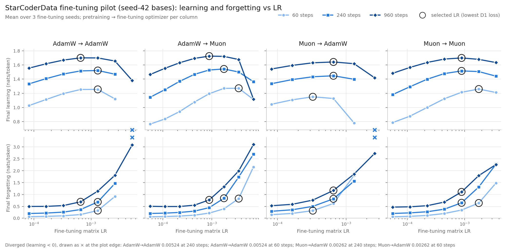

# E=8 MoE fine-tuning pilot: decisions and learning-rate sweeps

2026-11-25 · Harry

Exported 2026-11-26 from https://claude.ai/artifact/2uN17JfULvGvtcTFzYUgKx (doc revision 28, current to about 06:30 on 26 November). Since then the seed-43/44 main grids and the long StarCoderData pilot have completed; see `HANDOFF.md` §6 and `LOG_CHANGES.md` for those results. The before/after replay-fix comparison was added locally on 26 November.

## Summary

The fine-tuning pilot has run all four optimizer pairs on the seed-42 base models, on StarCoderData (60, 240 and 960 steps) and WikiText (60, 240 and 720 steps), three seeds per cell. Both pilots were rerun on 26 November after a data-replay bug; every selected learning rate is inside its grid, and 22 of 24 LR winners are unchanged. Two winners changed on rerun: StarCoderData AdamW → Muon at 60 steps (unaffected by the bug) and WikiText Muon → AdamW at 240 steps (affected).

**Replay bug (fixed).** In the first pilot, the 240-step runs trained steps 49–60 on one repeated batch, and the 960/720-step runs also steps 193–240. It cut WikiText learning by up to 1 nat mid-run and approximately 6–8% at the end; 60-step runs were unaffected. Except for the explicitly labeled before/after comparison, results here are from the clean rerun.

- Seeds agree closely: learning varies by 0.005 nats or less between seeds, so 3 fine-tuning seeds are enough.
- Length matters: from 240 to 960 steps learning rises another 0.18–0.19 nats at the selected rates, while forgetting at a given rate rises up to 2.5×.
- Picking the learning rate by lowest held-out fine-tuning loss favours rates that add little learning for a lot of forgetting, most of all for AdamW fine-tuning.
- The evaluation was rebuilt during the pilot: documents are now laid out in rows as in pretraining, which removed a 0.24-nat artefact in the base models' held-out loss.

No mismatch comparison is reported here: it waits for ℓ0 to be chosen from the curves.

## Pilot design

Each run starts from a seed-42 E=8 base model and fine-tunes it on StarCoderData (Python) with one optimizer. A run is a 960-step trunk; the 60- and 240-step lengths branch off it before their own learning-rate decay, so one trunk gives all three lengths. WikiText uses the same design with a 720-step trunk.

| Setting | Value |
|---|---|
| Base models | `e8-main-adamw-s42` (AdamW, LR 1.311e-3) and `e8-main-muon-s42` (Muon, LR 8.874e-4), 3B tokens each |
| Optimizer pairs | AdamW → AdamW, AdamW → Muon, Muon → AdamW, Muon → Muon (pretraining → fine-tuning) |
| Fine-tuning data | StarCoderData `python/` file 0: 218,079 files, 486.8M GPT-2 tokens |
| Batch | 65,536 tokens per step (32 rows of 2,048) |
| Schedule | 8 warmup steps, constant, linear decay to 0 over the last 20% of each length |
| Lengths | 60, 240, 960 steps (3.9M, 15.7M, 62.9M tokens) |
| Learning-rate grid | 1/16, 1/8, 1/4, 1/2, 1, 2 × the fine-tuning optimizer's pretraining LR; StarCoderData also 4× (except Muon → AdamW) and 8× for AdamW → Muon |
| Seeds | 1, 2, 3 (a seed fixes the data order, identical across all cells) |
| Other settings | Weight decay 0; embedding and output-layer LRs 0.1× their pretraining values; balance loss on; fresh optimizer state |
| Checkpoints | Steps 2, 4, 8, … up to the start of the decay, then mid-decay and the last step (12 at 960 steps) |
| Measurements | At each checkpoint: loss on D0 (held-out FineWeb-Edu) and D1 (held-out StarCoderData), learning = drop in D1 loss, forgetting = rise in D0 loss, both in nats per token, plus routing statistics |

The AdamW and Muon branches of a pair see the same batches in the same order for a given seed, so differences between cells are not data noise.

## Decisions made

All were decided on 25 November 2026 and are recorded with reasons in `PRETRAINING_PROTOCOL.md`.

| Topic | Decision | Why |
|---|---|---|
| Far dataset | StarCoderData, Python files only (replaces codeparrot-clean) | Matches the report's dataset; Python keeps "far from FineWeb-Edu" clear-cut |
| StarCoderData D1 | 20,000 files sampled (seed 0) from the last Python file, which training never reads | The dataset has no validation split |
| WikiText D1 | Official validation + test + 510 training articles (removed from training), 632 articles | The official splits alone fill only 0.24M tokens; the default evaluation scores 1M |
| Document segmentation in evaluation | Rows built exactly as the pretraining loader builds them ("best-fit"): every row starts a document, no document crosses a row, long documents are cut at the row end | The old layout split documents across rows, so 49% of scored tokens lost their earlier context; this inflated the base models' D0 loss by about 0.24 nats (3.18 vs 2.93) |
| StarCoderData D1 composition | Keep best-fit: D1 scores 1,446 whole files of at most 2,048 tokens; longer files are never scored | Training makes the same selection, and D0 is built the same way; the report must state it |
| Learning-rate choice | Lowest final D1 loss, averaged over seeds; if it is a grid end, add 2× and 4× (or ½×, ¼×) | Conventional and comparable with Zhao et al.; the matched-learning frontier is a robustness check only |
| Checkpoints | Log-spaced: 2, 4, 8, …, end of constant phase, mid-decay, last step | Forgetting changes fastest early |
| Length | 60 / 240 / 960 steps from one trunk; WikiText 60 / 240 / 720 | 960 WikiText steps would need 1.28 passes over its training articles |
| Fine-tuning seeds | 3 | Pilot seeds agree to 0.005 nats in learning |
| Base models in the main grid | All three pretraining seeds (42, 43, 44) | Shows how the mismatch effect varies between base models |
| Learning rates for seeds 43 and 44 | Reuse the seed-42 choice per pair, dataset and length; no grid | Saves 3–5× compute; the grid runs once, on seed 42 |
| ℓ0 (learning level for comparing forgetting) | Chosen after seeing the curves, from the learning curves alone, before computing the forgetting contrast; the contrast is also reported over the whole common range | Keeps the choice of ℓ0 from steering the result |
| Main length | Open: the pilot lengths, or add a longer one | See Open decisions |

## Learning-rate sweeps

Every selected learning rate is inside its grid. In StarCoderData the selected rates fall or hold from 240 to 960 steps. The rerun changed one StarCoderData pick: AdamW → Muon at 60 steps moves to 3.55e-3, and its 8× point (7.10e-3) is clearly worse. The WikiText Muon → AdamW pick at 240 steps also changed (see the comparison below).

*Mean over seeds 1–3 of the clean rerun (84 cells); rings mark the selected LR. Generated by `python -m scripts.plot_finetune_pilot results/e8/finetune_pilot_starcoderdata_summary.json` (writes `results/e8/figures/`).*

Learning is the drop in held-out StarCoderData loss, so the highest learning is the lowest D1 loss, the selection rule. Within a pair, learning flattens near the selected rate while forgetting keeps climbing.

| Pair (pretraining → fine-tuning) | Grid (× pretraining LR) | 60 steps | 240 steps | 960 steps |
|---|---|---|---|---|
| AdamW → AdamW | 8.19e-5 … 5.24e-3 (1/16 … 4) | 1.31e-3 | 1.31e-3 | 6.55e-4 |
| AdamW → Muon | 5.55e-5 … 7.10e-3 (1/16 … 8) | 3.55e-3 | 1.77e-3 | 8.87e-4 |
| Muon → AdamW | 8.19e-5 … 2.62e-3 (1/16 … 2) | 3.28e-4 | 6.55e-4 | 6.55e-4 |
| Muon → Muon | 5.55e-5 … 3.55e-3 (1/16 … 4) | 1.77e-3 | 8.87e-4 | 8.87e-4 |

These are the StarCoderData rates the seed-43 and seed-44 base models use. Three are close calls, within 0.002 nats of D1 loss: AdamW → Muon at 60 steps (3.55e-3 vs 1.77e-3) and AdamW → AdamW at 60 and 960 steps (1.31e-3 vs 6.55e-4).

WikiText picks lower rates, all inside its 1/16 … 2× grid:

| Pair (pretraining → fine-tuning) | 60 steps | 240 steps | 720 steps |
|---|---|---|---|
| AdamW → AdamW | 3.28e-4 | 6.55e-4 | 6.55e-4 |
| AdamW → Muon | 8.87e-4 | 8.87e-4 | 8.87e-4 |
| Muon → AdamW | 1.64e-4 | 3.28e-4 | 3.28e-4 |
| Muon → Muon | 4.44e-4 | 4.44e-4 | 4.44e-4 |

The 720-step WikiText rates equal those of Nazar's earlier seed-43/44 runs, which had no branches and so no bug; they are reused in the main grid.

## Before vs. after the replay fix (added 2026-11-26)

The tables compare the winning LR in each pilot, chosen by minimum mean final D1 loss over fine-tuning seeds 1–3 on the same seed-42 bases. Values are old → clean; learning and forgetting are in nats/token, and LR is in units of 10⁻³. The old 240/720/960-step runs are **invalid** and shown solely to document the impact of the bug. The old 60-step branches were unaffected. This is an endpoint comparison, not a matched-learning mismatch contrast.

**22 of 24 LR winners are unchanged.** Both changed winners doubled their rate, but only the 240-step WikiText change is in a replay-affected run. The 60-step StarCoderData change is a near-tie between two independently rerun, unaffected branches.

### StarCoderData (Python)

| Pretrain → fine-tune | Steps | LR (×10⁻³), old → clean | Learning, old → clean | Forgetting, old → clean |
|---|---:|---:|---:|---:|
| AdamW → AdamW | 60 | 1.311 | 1.262 → 1.255 | 0.323 → 0.323 |
| AdamW → AdamW | 240 | 1.311 | 1.511 → 1.521 | 0.718 → 0.685 |
| AdamW → AdamW | 960 | 0.655 | 1.689 → 1.699 | 0.719 → 0.692 |
| AdamW → Muon | 60 | **1.775 → 3.550** | 1.270 → 1.271 | 0.396 → 0.827 |
| AdamW → Muon | 240 | 1.775 | 1.528 → 1.543 | 0.882 → 0.841 |
| AdamW → Muon | 960 | 0.887 | 1.710 → 1.724 | 0.802 → 0.772 |
| Muon → AdamW | 60 | 0.328 | 1.151 → 1.151 | 0.319 → 0.320 |
| Muon → AdamW | 240 | 0.655 | 1.436 → 1.447 | 0.860 → 0.817 |
| Muon → AdamW | 960 | 0.655 | 1.631 → 1.641 | 1.206 → 1.170 |
| Muon → Muon | 60 | 1.775 | 1.260 → 1.260 | 0.643 → 0.641 |
| Muon → Muon | 240 | 0.887 | 1.502 → 1.515 | 0.668 → 0.651 |
| Muon → Muon | 960 | 0.887 | 1.684 → 1.698 | 1.145 → 1.108 |

### WikiText-103

| Pretrain → fine-tune | Steps | LR (×10⁻³), old → clean | Learning, old → clean | Forgetting, old → clean |
|---|---:|---:|---:|---:|
| AdamW → AdamW | 60 | 0.328 | 0.162 → 0.162 | 0.084 → 0.084 |
| AdamW → AdamW | 240 | 0.655 | 0.257 → 0.271 | 0.250 → 0.229 |
| AdamW → AdamW | 720 | 0.655 | 0.367 → 0.388 | 0.363 → 0.342 |
| AdamW → Muon | 60 | 0.887 | 0.163 → 0.163 | 0.133 → 0.133 |
| AdamW → Muon | 240 | 0.887 | 0.267 → 0.281 | 0.262 → 0.256 |
| AdamW → Muon | 720 | 0.887 | 0.378 → 0.405 | 0.381 → 0.366 |
| Muon → AdamW | 60 | 0.164 | 0.135 → 0.135 | 0.099 → 0.099 |
| Muon → AdamW | 240 | **0.164 → 0.328** | 0.219 → 0.227 | 0.162 → 0.222 |
| Muon → AdamW | 720 | 0.328 | 0.318 → 0.337 | 0.330 → 0.315 |
| Muon → Muon | 60 | 0.444 | 0.156 → 0.156 | 0.113 → 0.113 |
| Muon → Muon | 240 | 0.444 | 0.259 → 0.272 | 0.211 → 0.206 |
| Muon → Muon | 720 | 0.444 | 0.364 → 0.391 | 0.315 → 0.304 |

### What changed

- **StarCoderData, AdamW → Muon, 60 steps:** the winner moved from 1.775e-3 to 3.550e-3. The old D1 losses were 1.5790 vs 1.5798 (favoring the lower rate); the clean losses are 1.5801 vs 1.5786 (favoring the higher rate). At the clean lower rate, forgetting is 0.3954; at the higher rate it is 0.8268. Both 60-step runs were unaffected by the replay bug; the near-tie changed under rerun variability. The additional 7.10e-3 point lost clearly.
- **WikiText, Muon → AdamW, 240 steps:** the winner moved from 1.638e-4 to 3.277e-4. Old D1 losses were 2.9421 vs 2.9442; clean losses are 2.9345 vs 2.9336. At the *same* old LR, learning rose by 0.0077 and forgetting fell by 0.0078; at the *same* new LR, learning rose by 0.0106 and forgetting fell by 0.0148. The higher-rate winner adds only about 0.0008 nats of learning over the clean lower rate but increases forgetting from 0.1544 to 0.2222.
- At the original winning rates, every affected arm and length learned more and forgot less after the fix. StarCoderData learning increased by 0.0098–0.0145 nats and forgetting fell by 0.0173–0.0434. WikiText learning increased by 0.0077–0.0269 nats and forgetting fell by 0.0056–0.0214. At the longest WikiText length, the improvement was 0.0189–0.0269 nats (about 6–7% of the old learning).
- The final selected LRs on the longest horizons were unchanged for all four optimizer pairs in both corpora, and all clean winners are interior. The old WikiText 1× Muon LR for AdamW → Muon was a grid edge; the clean 2× extension brackets it.

Sources: the original 78-cell StarCoderData summary at Git revision `ed76421`, the reconstructed [old WikiText summary](../results/e8/archive/finetune_pilot_wikitext103_pre_replay_fix_summary.json) (60 cells, archived for diagnostics only), and the clean [StarCoderData](../results/e8/finetune_pilot_starcoderdata_summary.json) and [WikiText](../results/e8/finetune_pilot_wikitext103_summary.json) summaries (84 and 72 cells, respectively). Old and clean WikiText runs were checked to share best-fit D0/D1 hashes; all archived cells contained the three completed seeds.

## Observations

The pilot settles the seed count and the learning-rate grid; it does not yet say anything about optimizer mismatch.

- **Seed noise is small.** Across seeds, learning varies by at most 0.006 nats per token and forgetting by at most 0.04, except at the highest learning rates, where runs become unstable (Muon → AdamW at 1.31e-3 and 60 steps: learning 0.79 ± 0.10).
- **The best learning rate falls as runs get longer** for Muon fine-tuning: 3.55e-3, 1.77e-3, 8.87e-4 at 60, 240, 960 steps from the AdamW base; 1.77e-3, 8.87e-4, 8.87e-4 from the Muon base.
- **Longer runs keep learning and forgetting.** At each pair's selected rate, going from 240 to 960 steps adds 0.18–0.19 nats of learning, and forgetting at a given rate rises up to 2.5× (barely at the highest rates).
- **The held-out fine-tuning loss is flat near its minimum while forgetting is not.** AdamW → Muon at 60 steps: 1.77e-3 beats 8.87e-4 by 0.075 nats of learning but forgets 0.40 instead of 0.22. Choosing by lowest D1 loss therefore lands on rates with high forgetting.
- **The pilot cannot show a mismatch effect yet.** The two base models start from different D1 losses, and pairs differ in learning rate; the comparison needs forgetting at matched learning (ℓ0), computed once the selection is final.

## Compute and outputs

The clean rerun took about 12 B200-hours on hgo (28 jobs, both datasets, 26 November). The table lists the first pilot's jobs (about 6.4 B200-hours); their 240- and 960-step results are void.

| Job | Account | Pair (pretraining → fine-tuning) | Learning rates | Time |
|---|---|---|---|---|
| 30500290 | hgo | AdamW → Muon | 5-point grid | 1 h 17 min |
| 30500292 | hgo | Muon → AdamW | 5-point grid | 1 h 09 min |
| 30503463 | Nazar | AdamW → AdamW | 5-point grid | 1 h 15 min |
| 30503466 | Nazar | Muon → Muon | 5-point grid | 1 h 11 min |
| 30512566 | hgo | AdamW → Muon | 2×, 4× | 30 min |
| 30515353 | Nazar | Muon → Muon | 2×, 4× | 29 min |
| 30521188 | hgo | AdamW → AdamW | 2×, 4× | 29 min |

Each 960-step trunk with its two branches takes about 4.8 minutes on one B200.

- Rerun outputs, both datasets: `/orcd/scratch/orcd/014/hgo/public/nanochat-optimizer-mismatch/finetune_pilot/`
- Nazar outputs (first pilot, void at 240/960 steps; also the reused seed-43/44 WikiText runs): `/orcd/scratch/orcd/010/ndrugov/finetune_pilot/` (his analysis is in `analysis/`)
- Per run: `config.json`, `result.json`, `metrics.jsonl`, and a `ckpt_<step>.npz` of per-document losses and routes at each checkpoint (no model weights).

## Open decisions and next steps

Two decisions remain open; the main grids at the selected rates are already running.

- [ ] **Main length.** Keep 60 / 240 / 960 steps, or add a longer StarCoderData length. Suggested test: if the mismatch difference has stopped changing between 240 and 960 steps, 960 is long enough. WikiText cannot exceed about 740 steps without repeating articles. A 3,200-step StarCoderData pilot (branches at 60, 240, 960 and 1,920 steps) is running to inform this.
- [ ] **ℓ0.** Pick from the learning curves (a level every cell reaches), then compute the forgetting contrast at it and across the whole common range.

Then, in order:

1. Main grids on seeds 43 and 44, both datasets, at the selected rates, 3 seeds each: running on hgo since 26 November.
2. Long StarCoderData pilot on seed 42 (3,200 steps): queued behind the main grids.
3. Run the analysis across both accounts' outputs and report the mismatch effect at matched learning.
