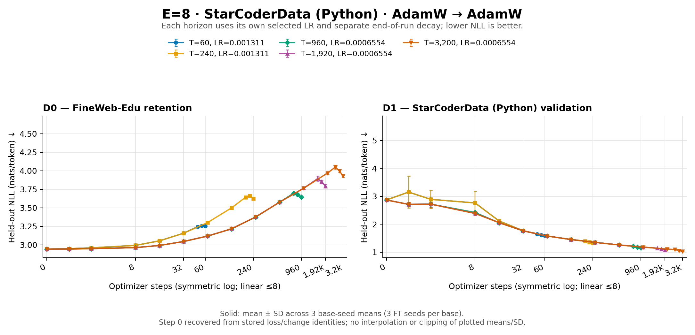
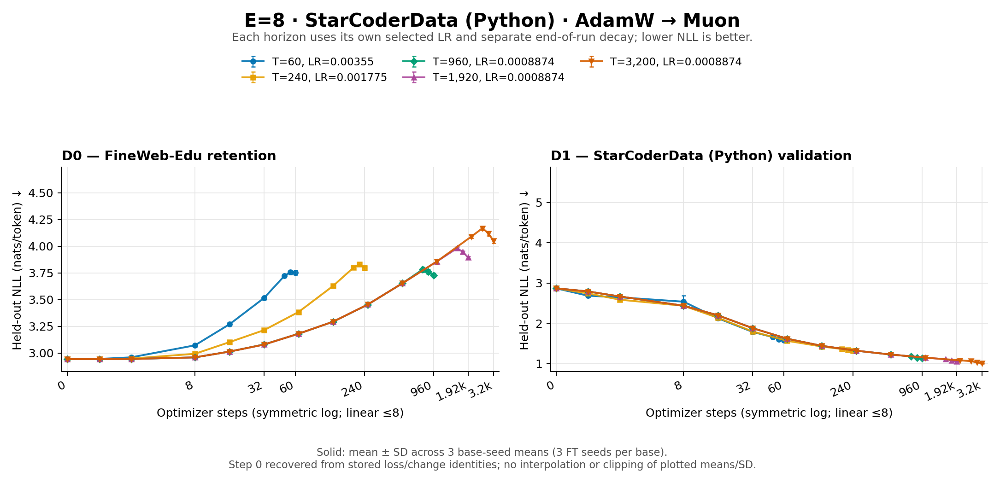
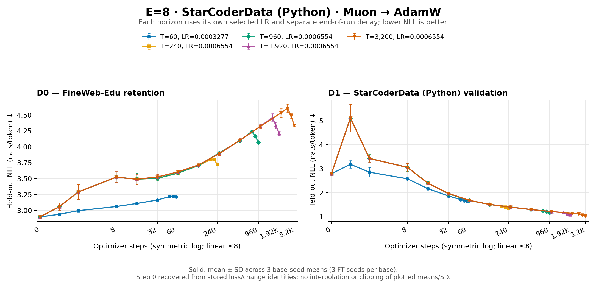
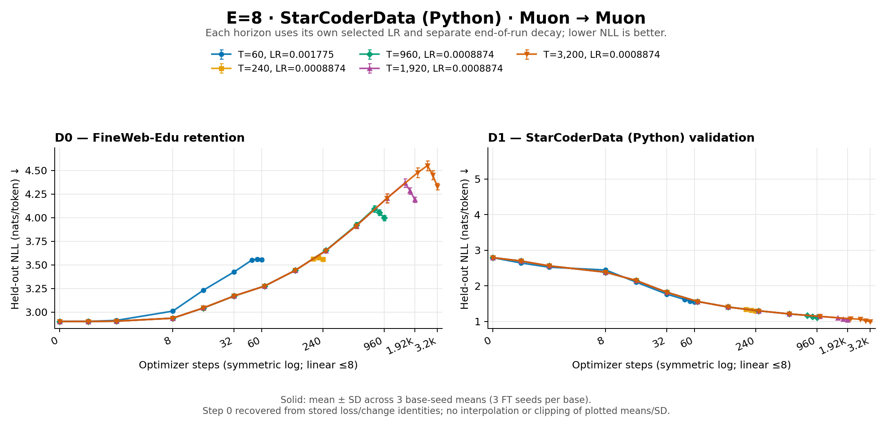
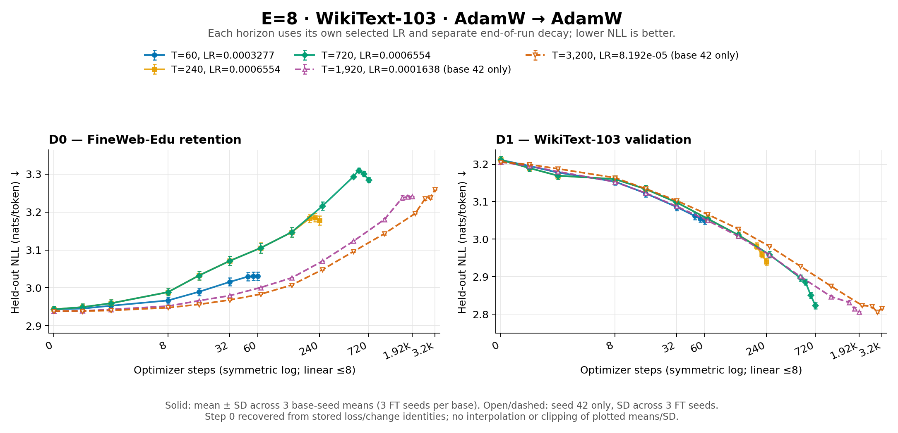
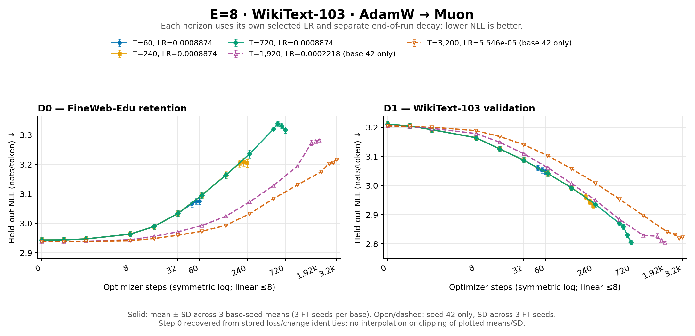
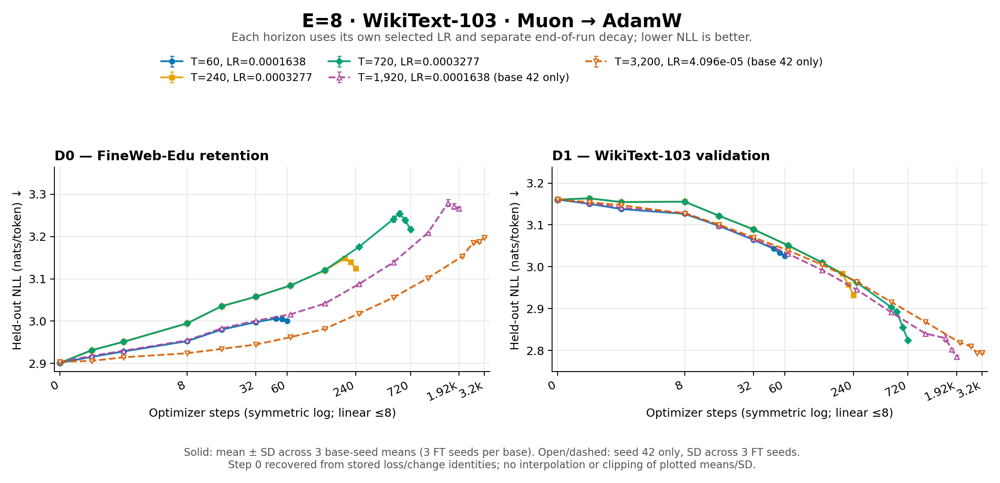
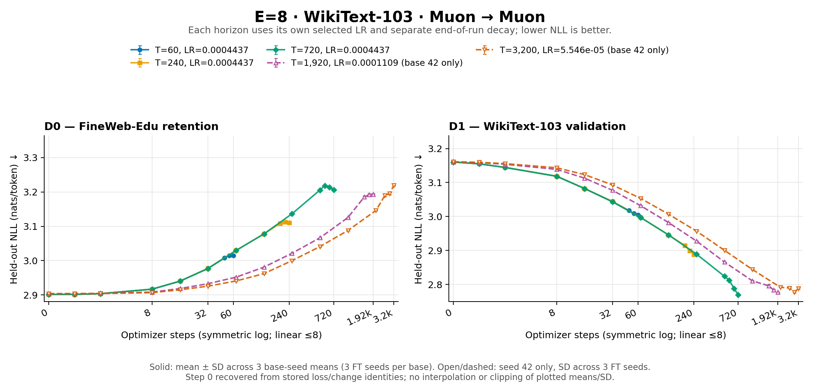

# E=8 fine-tuning: raw validation NLL trajectories

**2026-11-27 · clean selected-LR branches at every completed horizon.**

## What is measured

The earlier endpoint report describes learning (improvement on D1) and forgetting (degradation on D0) relative to the pretrained model. Here we show the **absolute held-out token-weighted cross-entropy / negative log-likelihood (NLL), nats/token**, for both validation sets at every saved checkpoint. Lower is better. The evaluation code (`scripts/finetune.py`) records true-token losses, document loss sums, and routing choices; it does not log next-token top-1 accuracy or preserve predicted vocabulary-token IDs. Accuracy cannot be reconstructed from NLL or expert routing, and no accuracy claim is made. No training or new evaluation compute was used.

- D0: held-out FineWeb-Edu, the original distribution.
- D1: held-out StarCoderData (Python) or WikiText-103, the fine-tuning distribution.
- Each curve is one separately selected learning rate and one training horizon, with its own final decay schedule. A longer curve is not an extension of the already-decayed shorter endpoint. Branches may share pre-decay prefix evaluations; overlapping curves and observations at different checkpoints should not be counted as independent evidence.
- For StarCoderData at all five horizons and WikiText through 720 steps, each point is the mean of three pretrained-seed means (each averaging three fine-tuning seeds), with ±1 sample SD across pretrained-seed means. For the 1,920/3,200-step WikiText pilot, dashed/open curves use pretrained seed 42 only, mean ±1 SD across its three fine-tuning seeds. These are not confidence intervals.
- We plot only saved checkpoints plus the step-0 baseline reconstructed exactly from the stored definitions: D0(0) = D0(t) − forgetting(t); D1(0) = D1(t) + learning(t). Both identities are consistent at every saved checkpoint and across all horizons/FT seeds for the same pretrained base; D0 also agrees between the two corpora. Lines connect measurements, with no synthetic interpolated checkpoints. The x-axis is symmetric log, linear through step 8 to include step 0. Within each dataset, identical D0 and D1 y-axis ranges across all four optimizer-pair figures include all plotted means and SD (no warmup spikes clipped).

## Trajectories (eight figures)

### StarCoderData (Python)

**AdamW → AdamW**



**AdamW → Muon**



**Muon → AdamW**



**Muon → Muon**



### WikiText-103

**AdamW → AdamW**



**AdamW → Muon**



**Muon → AdamW**



**Muon → Muon**



## Raw baseline losses (step 0)

| Pretraining optimizer | Base seed | D0 FineWeb-Edu NLL | D1 StarCoderData NLL | D1 WikiText-103 NLL |
|---|---:|---:|---:|---:|
| AdamW | 42 | 2.9386 | 2.8495 | 3.2056 |
| AdamW | 43 | 2.9383 | 2.8574 | 3.2069 |
| AdamW | 44 | 2.9532 | 2.8938 | 3.2216 |
| Muon | 42 | 2.9037 | 2.8054 | 3.1611 |
| Muon | 43 | 2.9017 | 2.7507 | 3.1610 |
| Muon | 44 | 2.8986 | 2.8148 | 3.1594 |

## Raw final validation losses

Each cell is **mean D0 NLL / mean D1 NLL** in nats/token at that curve’s final checkpoint. All 312 per-seed final values, base losses, and loss changes appear in the enriched endpoint CSV; the [expanded endpoint report](finetuning_mismatch_endpoints.md#raw-endpoint-data) has per-seed tables and separate mean ± SD columns for both raw losses. The long WikiText values are seed-42-only, not population means.

### StarCoderData (Python)

| Pretrain → fine-tune | 60 | 240 | 960 | 1,920 | 3,200 |
|---|---:|---:|---:|---:|---:|
| AdamW → AdamW | 3.2555 / 1.5834 | 3.6256 / 1.3295 | 3.6469 / 1.1538 | 3.7936 / 1.0789 | 3.9274 / 1.0290 |
| AdamW → Muon | 3.7527 / 1.5807 | 3.7973 / 1.3101 | 3.7279 / 1.1284 | 3.8931 / 1.0523 | 4.0492 / 1.0026 |
| Muon → AdamW | 3.2132 / 1.6502 | 3.7208 / 1.3656 | 4.0675 / 1.1700 | 4.2154 / 1.0904 | 4.3392 / 1.0387 |
| Muon → Muon | 3.5543 / 1.5475 | 3.5585 / 1.2935 | 3.9975 / 1.1108 | 4.1904 / 1.0389 | 4.3296 / 0.9924 |

### WikiText-103

| Pretrain → fine-tune | 60 | 240 | 720 | 1,920 (42 only) | 3,200 (42 only) |
|---|---:|---:|---:|---:|---:|
| AdamW → AdamW | 3.0305 / 3.0491 | 3.1777 / 2.9399 | 3.2846 / 2.8225 | 3.2405 / 2.8051 | 3.2594 / 2.8155 |
| AdamW → Muon | 3.0752 / 3.0475 | 3.2048 / 2.9298 | 3.3172 / 2.8052 | 3.2827 / 2.8044 | 3.2176 / 2.8224 |
| Muon → AdamW | 3.0007 / 3.0255 | 3.1250 / 2.9326 | 3.2168 / 2.8240 | 3.2658 / 2.7848 | 3.1977 / 2.7939 |
| Muon → Muon | 3.0148 / 3.0047 | 3.1099 / 2.8885 | 3.2066 / 2.7690 | 3.1932 / 2.7768 | 3.2189 / 2.7880 |

## Observations from the trajectories

- StarCoderData’s longer selected-LR trajectories continue improving D1 while generally increasing D0. All four 1,920- and 3,200-step arms have their best **recorded mean D1** at the final step. Muon → AdamW has a pronounced early D1 spike at step 2 in the 960-step arm (mean 5.1123 nats/token); the trajectories retain it rather than hide its SD or change scale for that pair.
- WikiText’s long-horizon selected LRs are much lower than the shorter-horizon winners. All four 3,200-step seed-42-only curves reach a lower mean D1 at step 2,880 than at their final checkpoint; no claim about a preselected optimal stopping time follows from this descriptive inspection. The lower long-horizon LRs also change the forgetting trajectory; these are comparisons between separately tuned lengths, not a pure causal effect of training more steps.
- Raw NLL makes different starting losses visible (e.g. StarCoderData D1 baselines differ more between pretraining seeds than WikiText D1). The mismatch effect must still be measured as forgetting at a common learning level within each base, not by comparing absolute D0 losses between differently pretrained models. Choosing ℓ0 and performing the prespecified matched-learning comparison and routing analyses remain separate scientific steps.

## Data, provenance, and reproduction

- [Enriched endpoint CSV (312 run endpoints)](../results/e8/finetune_endpoint_runs.csv): raw `loss_d0`, `loss_d1`, `base_loss_d0`, `base_loss_d1` added to the exact original selected-run index, which preserves learning, forgetting, LR, seeds, and source paths.
- [Validation trajectories CSV (3,768 rows)](../results/e8/finetune_validation_trajectories.csv): 3,456 saved checkpoint measurements + one step-0 baseline row per selected run; no duplicate reruns or invalid archives. The selected grid contains 288 fully replicated endpoints and 24 seed-42-only WikiText long endpoints. Run identities, endpoint values, exact LRs and stored checkpoint schedules were checked against result/config records. The 24 staging aliases for Nazar’s standalone 720-step WikiText runs map to his original result/config records.

Reproduce extraction (actual ORCD paths or the local result/config mirror; no checkpoint tensors needed) and figures (tracked CSV alone):

```sh
python -m scripts.finetune_validation_trajectories extract \
  --endpoints results/e8/finetune_endpoint_runs.csv \
  --out results/e8/finetune_validation_trajectories.csv \
  --endpoint-out results/e8/finetune_endpoint_runs.csv

python -m scripts.finetune_validation_trajectories plot \
  --trajectories results/e8/finetune_validation_trajectories.csv \
  --out-dir results/e8/figures/finetune_validation
```
