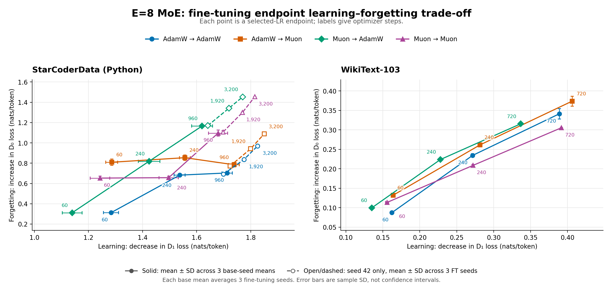

# E=8 optimizer mismatch: endpoint learning–forgetting curves

**2026-11-26 · Interim experimental report** (long WikiText pilot submitted; not yet included).

## Question and scope

The first question in `docs/report.tex` is whether switching optimizers between pretraining and fine-tuning increases forgetting at the same learning on an MoE. This report describes the endpoint evidence to date, before the prespecified matched-learning analysis and correlated/causal routing analysis. Positive learning is the drop in held-out fine-tuning loss (D1); positive forgetting is the rise in held-out pretraining loss (D0), both in nats per token.

The main E=8 grid has three pretrained seeds (42, 43, 44) for each optimizer, each fine-tuned with seeds 1–3. Each optimizer pair/dataset/length uses the LR minimizing mean final D1 on the seed-42 pilot, then reused on the other pretrained bases. StarCoderData's long pilot has only pretrained seed 42, again three fine-tuning seeds, and its 960-step LR is also optimal at 1,920 and 3,200 steps. Results are from the clean, post-replay-fix pilots and the validated standalone WikiText main runs; contaminated results are excluded.

## Endpoint learning–forgetting curves

- Solid curves: means of the three pretraining-seed means; each of those means uses three fine-tuning seeds (9 runs per point). Horizontal/vertical bars are ±1 sample SD **across the three base means**; they are not confidence intervals.
- Open markers and dashed curves: long pilot means for pretraining seed 42 only, ±1 sample SD across fine-tuning seeds 1–3. The dashed line starts at the seed-42 mean of the last fully replicated length, rather than the three-base mean. These intervals describe different sources of variability and are not comparable as estimates of population uncertainty.
- Labels are training steps. These connect endpoints of separately decayed schedules at separately selected LRs, not checkpoints along a single run. They illustrate length dependence but are not the formal matched-learning curves of the paper.

## What the data suggest

- **StarCoderData, AdamW-pretrained:** at 60 steps AdamW → AdamW and AdamW → Muon achieve nearly identical mean learning (1.2835 vs 1.2863), but switching to Muon forgets much more (0.8093 vs 0.3121). At 240 and 960, the switching arm still forgets more and learns slightly more, so exact matched-learning inference requires the saved checkpoint curves.
- **StarCoderData, Muon-pretrained:** at 240 and 960 steps Muon → AdamW has both lower mean learning and higher mean forgetting than Muon → Muon. At 960 the endpoints are 1.6203/1.1662 versus 1.6795/1.0961. At 3,200 (seed 42 only), the two forgetting endpoints are almost the same (1.4531 vs 1.4548) although the switching arm learns less. This is suggestive, not evidence that the mismatch penalty disappears at a fixed learning level.
- **WikiText, AdamW-pretrained:** the 60-step points again have close learning (0.1622 vs 0.1639) and greater forgetting under a switch to Muon (0.1318 vs 0.0871). At 240 and 720 the mismatched arm has more learning and more forgetting, requiring a matched-learning comparison.
- **WikiText, Muon-pretrained:** the 240- and 720-step mismatched endpoints have lower learning and higher forgetting than the matched endpoints. At 720 steps these are 0.3365/0.3155 versus 0.3915/0.3053. The 60-step endpoint alone does not settle the mismatch effect.
- **The most convincing provisional pattern** is direction- and horizon-dependent extra forgetting: the evidence is consistent with a mismatch cost in both corpora, especially early AdamW → Muon and the intermediate/long Muon → AdamW endpoints. No statistical significance or causal router attribution is claimed here. The protocol calls for choosing ℓ0 solely from common learning support before computing mismatch contrasts, then reporting the entire supported range as a robustness check.

## Raw endpoint data

Tables show the observed means and the same standard deviations as the graph, not matching or extrapolating learning levels. The expandable tables provide every individual fine-tuning seed's observed learning/forgetting pair; the [full precision endpoint CSV](../results/e8/finetune_endpoint_runs.csv) includes each source run's path. All values are nats/token except LR and training steps.

### StarCoderData (Python)

| Pretrain → fine-tune | Steps | Pretrain seeds | LR | Learning (mean ± SD) | Forgetting (mean ± SD) |
|---|---:|:---:|---:|---:|---:|
| AdamW → AdamW | 60 | 42, 43, 44 | 0.00131 | 1.2835 ± 0.0278 | 0.3121 ± 0.0115 |
| AdamW → AdamW | 240 | 42, 43, 44 | 0.00131 | 1.5374 ± 0.0205 | 0.6822 ± 0.0123 |
| AdamW → AdamW | 960 | 42, 43, 44 | 0.000655 | 1.7131 ± 0.0188 | 0.7035 ± 0.0176 |
| AdamW → AdamW | 1,920 | 42 | 0.000655 | 1.7750 ± 0.0011 | 0.8361 ± 0.0052 |
| AdamW → AdamW | 3,200 | 42 | 0.000655 | 1.8252 ± 0.0001 | 0.9681 ± 0.0035 |
| AdamW → Muon | 60 | 42, 43, 44 | 0.00355 | 1.2863 ± 0.0221 | 0.8093 ± 0.0307 |
| AdamW → Muon | 240 | 42, 43, 44 | 0.00177 | 1.5568 ± 0.0197 | 0.8539 ± 0.0259 |
| AdamW → Muon | 960 | 42, 43, 44 | 0.000887 | 1.7385 ± 0.0193 | 0.7845 ± 0.0219 |
| AdamW → Muon | 1,920 | 42 | 0.000887 | 1.7998 ± 0.0007 | 0.9419 ± 0.0006 |
| AdamW → Muon | 3,200 | 42 | 0.000887 | 1.8499 ± 0.0002 | 1.0880 ± 0.0031 |
| Muon → AdamW | 60 | 42, 43, 44 | 0.000328 | 1.1401 ± 0.0364 | 0.3118 ± 0.0100 |
| Muon → AdamW | 240 | 42, 43, 44 | 0.000655 | 1.4247 ± 0.0400 | 0.8195 ± 0.0112 |
| Muon → AdamW | 960 | 42, 43, 44 | 0.000655 | 1.6203 ± 0.0385 | 1.1662 ± 0.0140 |
| Muon → AdamW | 1,920 | 42 | 0.000655 | 1.7193 ± 0.0006 | 1.3408 ± 0.0028 |
| Muon → AdamW | 3,200 | 42 | 0.000655 | 1.7703 ± 0.0008 | 1.4531 ± 0.0067 |
| Muon → Muon | 60 | 42, 43, 44 | 0.00177 | 1.2428 ± 0.0360 | 0.6530 ± 0.0193 |
| Muon → Muon | 240 | 42, 43, 44 | 0.000887 | 1.4968 ± 0.0354 | 0.6571 ± 0.0146 |
| Muon → Muon | 960 | 42, 43, 44 | 0.000887 | 1.6795 ± 0.0351 | 1.0961 ± 0.0294 |
| Muon → Muon | 1,920 | 42 | 0.000887 | 1.7694 ± 0.0008 | 1.2993 ± 0.0026 |
| Muon → Muon | 3,200 | 42 | 0.000887 | 1.8153 ± 0.0006 | 1.4548 ± 0.0006 |

Raw learning / forgetting pairs for each seed

Each cell lists (learning / forgetting) for fine-tuning seeds 1, 2, 3, respectively. Values rounded to four decimals; the CSV preserves full precision.

| Pair | Steps | Base seed 42 | Base seed 43 | Base seed 44 |
|---|---:|---|---|---|
| AdamW → AdamW | 60 | 1.2628 / 0.3014 1.2389 / 0.3276 1.2639 / 0.3414 | 1.2822 / 0.2977 1.2869 / 0.3286 1.2847 / 0.3113 | 1.3109 / 0.2922 1.3083 / 0.3039 1.3132 / 0.3050 |
| AdamW → AdamW | 240 | 1.5219 / 0.6828 1.5173 / 0.6855 1.5237 / 0.6871 | 1.5303 / 0.6977 1.5306 / 0.6822 1.5322 / 0.6984 | 1.5580 / 0.6779 1.5623 / 0.6540 1.5607 / 0.6741 |
| AdamW → AdamW | 960 | 1.6999 / 0.6850 1.6985 / 0.7072 1.6995 / 0.6832 | 1.7058 / 0.7224 1.7053 / 0.7276 1.7055 / 0.7213 | 1.7353 / 0.6931 1.7338 / 0.6972 1.7347 / 0.6947 |
| AdamW → AdamW | 1,920 | 1.7752 / 0.8391 1.7738 / 0.8391 1.7760 / 0.8300 | — | — |
| AdamW → AdamW | 3,200 | 1.8250 / 0.9720 1.8253 / 0.9652 1.8251 / 0.9672 | — | — |
| AdamW → Muon | 60 | 1.2677 / 0.8171 1.2708 / 0.8384 1.2743 / 0.8250 | 1.2719 / 0.7815 1.2752 / 0.8535 1.2816 / 0.8466 | 1.3099 / 0.7433 1.3102 / 0.7686 1.3146 / 0.8096 |
| AdamW → Muon | 240 | 1.5417 / 0.8515 1.5421 / 0.8323 1.5440 / 0.8403 | 1.5462 / 0.8988 1.5502 / 0.8629 1.5492 / 0.8894 | 1.5798 / 0.8585 1.5799 / 0.8167 1.5785 / 0.8349 |
| AdamW → Muon | 960 | 1.7245 / 0.7692 1.7228 / 0.7781 1.7247 / 0.7694 | 1.7314 / 0.8088 1.7305 / 0.8124 1.7312 / 0.8081 | 1.7612 / 0.7645 1.7592 / 0.7793 1.7609 / 0.7706 |
| AdamW → Muon | 1,920 | 1.8005 / 0.9415 1.7992 / 0.9415 1.7997 / 0.9425 | — | — |
| AdamW → Muon | 3,200 | 1.8499 / 1.0851 1.8500 / 1.0876 1.8497 / 1.0912 | — | — |
| Muon → AdamW | 60 | 1.1519 / 0.2938 1.1481 / 0.3355 1.1525 / 0.3295 | 1.0954 / 0.2907 1.0976 / 0.3001 1.1055 / 0.3111 | 1.1715 / 0.3150 1.1733 / 0.3131 1.1646 / 0.3179 |
| Muon → AdamW | 240 | 1.4448 / 0.8233 1.4497 / 0.8069 1.4460 / 0.8205 | 1.3787 / 0.8228 1.3821 / 0.8180 1.3748 / 0.8544 | 1.4471 / 0.8162 1.4520 / 0.7996 1.4473 / 0.8134 |
| Muon → AdamW | 960 | 1.6414 / 1.1606 1.6407 / 1.1827 1.6420 / 1.1662 | 1.5756 / 1.1480 1.5759 / 1.1759 1.5761 / 1.1284 | 1.6439 / 1.1680 1.6434 / 1.1947 1.6433 / 1.1713 |
| Muon → AdamW | 1,920 | 1.7194 / 1.3435 1.7186 / 1.3379 1.7198 / 1.3410 | — | — |
| Muon → AdamW | 3,200 | 1.7693 / 1.4519 1.7707 / 1.4470 1.7708 / 1.4603 | — | — |
| Muon → Muon | 60 | 1.2601 / 0.6204 1.2573 / 0.6543 1.2624 / 0.6486 | 1.1978 / 0.6427 1.2028 / 0.6182 1.2035 / 0.6670 | 1.2657 / 0.6886 1.2602 / 0.6814 1.2750 / 0.6558 |
| Muon → Muon | 240 | 1.5154 / 0.6555 1.5148 / 0.6454 1.5162 / 0.6511 | 1.4555 / 0.6569 1.4569 / 0.6390 1.4553 / 0.6446 | 1.5185 / 0.6786 1.5202 / 0.6605 1.5181 / 0.6825 |
| Muon → Muon | 960 | 1.6985 / 1.0963 1.6977 / 1.1220 1.6982 / 1.1045 | 1.6400 / 1.0562 1.6379 / 1.0762 1.6390 / 1.0559 | 1.7014 / 1.1094 1.7011 / 1.1316 1.7016 / 1.1130 |
| Muon → Muon | 1,920 | 1.7699 / 1.2964 1.7685 / 1.3015 1.7700 / 1.2999 | — | — |
| Muon → Muon | 3,200 | 1.8147 / 1.4552 1.8153 / 1.4550 1.8159 / 1.4542 | — | — |

### WikiText-103

| Pretrain → fine-tune | Steps | Pretrain seeds | LR | Learning (mean ± SD) | Forgetting (mean ± SD) |
|---|---:|:---:|---:|---:|---:|
| AdamW → AdamW | 60 | 42, 43, 44 | 0.000328 | 0.1622 ± 0.0006 | 0.0871 ± 0.0030 |
| AdamW → AdamW | 240 | 42, 43, 44 | 0.000655 | 0.2715 ± 0.0007 | 0.2343 ± 0.0044 |
| AdamW → AdamW | 720 | 42, 43, 44 | 0.000655 | 0.3889 ± 0.0013 | 0.3412 ± 0.0133 |
| AdamW → Muon | 60 | 42, 43, 44 | 0.000887 | 0.1639 ± 0.0008 | 0.1318 ± 0.0030 |
| AdamW → Muon | 240 | 42, 43, 44 | 0.000887 | 0.2816 ± 0.0007 | 0.2614 ± 0.0054 |
| AdamW → Muon | 720 | 42, 43, 44 | 0.000887 | 0.4062 ± 0.0011 | 0.3738 ± 0.0127 |
| Muon → AdamW | 60 | 42, 43, 44 | 0.000164 | 0.1350 ± 0.0008 | 0.0994 ± 0.0011 |
| Muon → AdamW | 240 | 42, 43, 44 | 0.000328 | 0.2279 ± 0.0006 | 0.2237 ± 0.0017 |
| Muon → AdamW | 720 | 42, 43, 44 | 0.000328 | 0.3365 ± 0.0011 | 0.3155 ± 0.0035 |
| Muon → Muon | 60 | 42, 43, 44 | 0.000444 | 0.1558 ± 0.0020 | 0.1134 ± 0.0012 |
| Muon → Muon | 240 | 42, 43, 44 | 0.000444 | 0.2720 ± 0.0007 | 0.2086 ± 0.0026 |
| Muon → Muon | 720 | 42, 43, 44 | 0.000444 | 0.3915 ± 0.0005 | 0.3053 ± 0.0008 |

Raw learning / forgetting pairs for each seed

Each cell lists (learning / forgetting) for fine-tuning seeds 1, 2, 3, respectively. Values rounded to four decimals; the CSV preserves full precision.

| Pair | Steps | Base seed 42 | Base seed 43 | Base seed 44 |
|---|---:|---|---|---|
| AdamW → AdamW | 60 | 0.1627 / 0.0822 0.1598 / 0.0839 0.1625 / 0.0853 | 0.1641 / 0.0862 0.1608 / 0.0880 0.1638 / 0.0894 | 0.1638 / 0.0881 0.1594 / 0.0888 0.1632 / 0.0923 |
| AdamW → AdamW | 240 | 0.2709 / 0.2283 0.2719 / 0.2308 0.2693 / 0.2294 | 0.2730 / 0.2355 0.2720 / 0.2367 0.2710 / 0.2339 | 0.2721 / 0.2354 0.2721 / 0.2400 0.2712 / 0.2385 |
| AdamW → AdamW | 720 | 0.3882 / 0.3399 0.3872 / 0.3420 0.3877 / 0.3434 | 0.3886 / 0.3530 0.3883 / 0.3581 0.3892 / 0.3517 | 0.3905 / 0.3283 0.3900 / 0.3265 0.3901 / 0.3281 |
| AdamW → Muon | 60 | 0.1646 / 0.1287 0.1612 / 0.1322 0.1632 / 0.1370 | 0.1666 / 0.1275 0.1617 / 0.1295 0.1654 / 0.1286 | 0.1658 / 0.1317 0.1617 / 0.1337 0.1647 / 0.1376 |
| AdamW → Muon | 240 | 0.2814 / 0.2566 0.2813 / 0.2577 0.2797 / 0.2547 | 0.2832 / 0.2643 0.2825 / 0.2598 0.2808 / 0.2583 | 0.2825 / 0.2679 0.2817 / 0.2680 0.2811 / 0.2652 |
| AdamW → Muon | 720 | 0.4057 / 0.3680 0.4042 / 0.3634 0.4054 / 0.3678 | 0.4059 / 0.3894 0.4060 / 0.3881 0.4065 / 0.3877 | 0.4073 / 0.3704 0.4069 / 0.3607 0.4077 / 0.3684 |
| Muon → AdamW | 60 | 0.1358 / 0.0969 0.1325 / 0.0985 0.1355 / 0.1017 | 0.1371 / 0.1009 0.1333 / 0.1005 0.1376 / 0.1005 | 0.1363 / 0.0987 0.1321 / 0.0976 0.1352 / 0.0994 |
| Muon → AdamW | 240 | 0.2281 / 0.2208 0.2270 / 0.2232 0.2274 / 0.2228 | 0.2297 / 0.2254 0.2282 / 0.2282 0.2281 / 0.2232 | 0.2279 / 0.2262 0.2275 / 0.2223 0.2276 / 0.2209 |
| Muon → AdamW | 720 | 0.3365 / 0.3119 0.3361 / 0.3197 0.3370 / 0.3148 | 0.3355 / 0.3190 0.3349 / 0.3208 0.3357 / 0.3170 | 0.3374 / 0.3121 0.3376 / 0.3100 0.3379 / 0.3140 |
| Muon → Muon | 60 | 0.1578 / 0.1118 0.1528 / 0.1133 0.1566 / 0.1139 | 0.1590 / 0.1120 0.1551 / 0.1126 0.1593 / 0.1128 | 0.1551 / 0.1143 0.1518 / 0.1150 0.1544 / 0.1150 |
| Muon → Muon | 240 | 0.2724 / 0.2059 0.2715 / 0.2065 0.2707 / 0.2043 | 0.2736 / 0.2103 0.2730 / 0.2110 0.2719 / 0.2081 | 0.2717 / 0.2120 0.2719 / 0.2104 0.2712 / 0.2088 |
| Muon → Muon | 720 | 0.3910 / 0.3012 0.3904 / 0.3082 0.3918 / 0.3036 | 0.3913 / 0.3048 0.3915 / 0.3052 0.3918 / 0.3066 | 0.3923 / 0.3064 0.3916 / 0.3055 0.3921 / 0.3059 |

## Long WikiText extension and next step

Harry approved the seed-42 long pilot (1,920 and 3,200 steps with 60/240/720 shorter branches, three fine-tuning seeds per LR). Initial LR grid: ¼×, ½×, 1× the 720-step winner for each optimizer pair; apply the edge rule until bracketed. Jobs 30622317, 30622320, 30622321, 30622322 are submitted on hgo using the unchanged reviewed generator. The 3,200-step WikiText run processes about 4.28 effective epochs, versus about one for StarCoderData; this is intended but qualifies cross-corpus comparison. No long seed-43/44 run was authorized at this stage.

Once the extension is complete, verify the short branches, select each longer LR, and add its seed-42 endpoints to these curves and tables. The next scientific decision is the matched-learning target and main length; the routing correlation and replay analysis follow evidence for a baseline mismatch effect.

**Reproduce graph:** `python -m scripts.plot_finetune_endpoints results/e8/finetune_endpoint_runs.csv --out results/e8/figures/finetune_endpoints.png`. Data sources were the six clean ORCD `analysis/<dataset>-<steps>-main/analysis.json` selection manifests and the selected long StarCoderData result files; exactly 36 main endpoints per dataset/length and 12 seed-42 endpoints per long length were recovered.
