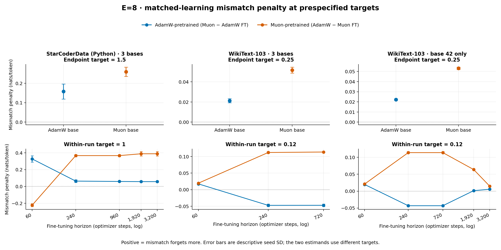
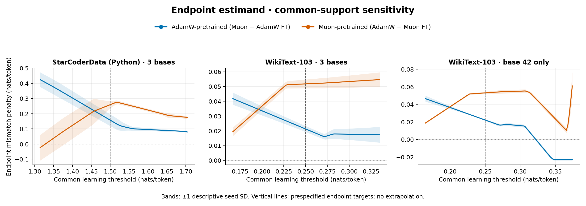
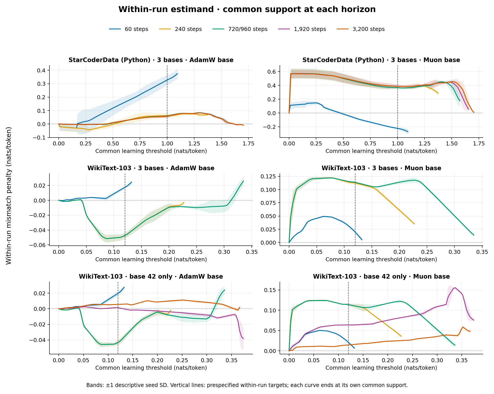
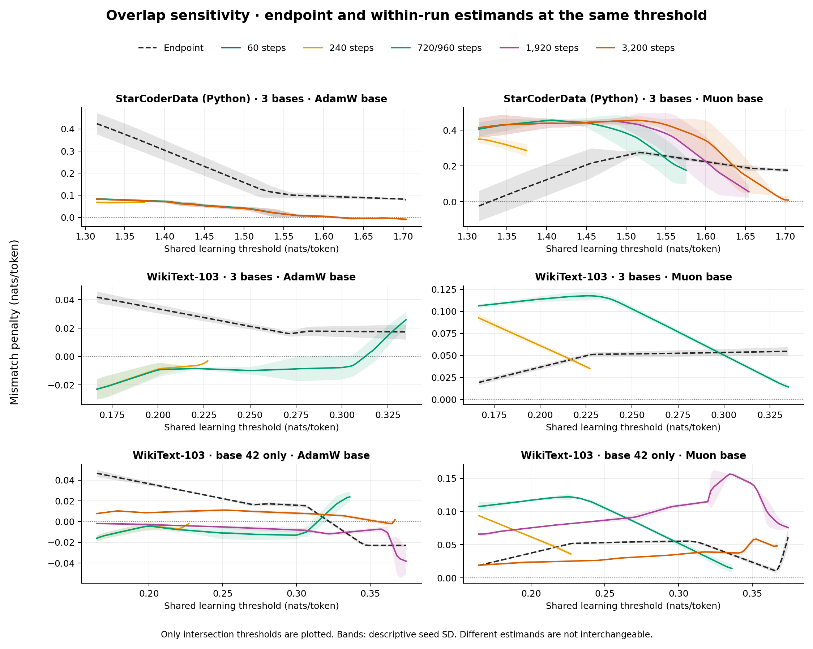

# E=8 optimizer mismatch at matched learning

**2026-11-27 · Prespecified endpoint and within-run analyses, clean selected-LR records.**

## Question and estimands

How much additional forgetting is associated with switching optimizers when requiring the same minimum learning? The two estimands and targets were approved and recorded in `PRETRAINING_PROTOCOL.md` before calculating the contrasts. Learning L is the held-out D1 NLL improvement and forgetting F is the held-out D0 NLL increase, both in nats/token.

| Estimand | StarCoderData target | WikiText-103 target | Curve searched |
|---|---:|---:|---|
| **Endpoint** | 1.50 | 0.25 | Final endpoints of separately optimized, separately decayed horizons, in horizon order |
| **Within-run** | 1.00 | 0.12 | Saved checkpoint curve at each fixed horizon and selected LR, including step zero |

For every selected run (or endpoint curve), the objective is **minimize F subject to L ≥ ℓ0**. We enumerate eligible vertices and every threshold crossing of adjacent linear segments in actual horizon/step order, including descending segments. There is no extrapolation or invented endpoint origin. Within-run curves include the genuine L=F=0 baseline. If any required seed lacks threshold support, the entire cohort/horizon is unsupported; all 16 approved comparison groups are supported here. The objective imposes a lower bound on learning, not equality: a selected vertex may have L > ℓ0. Interpolated endpoint crossings between independently decayed horizons are **not measured models or router interventions**.

For each base seed and FT seed, the penalty is mismatched-arm minimal F minus matched-arm minimal F. Positive means mismatch forgets more. For the main cohorts we average the three paired FT seeds within each base; the overall mean and ±1 sample SD are across three base means (nine paired observations per direction, three base-level units). The WikiText seed-42-only cohort instead reports mean/SD of the three FT seed pairs conditional on that base. Its short and long curves are analyzed consistently as one-base curves, not spliced into the three-base curves. These are descriptive SDs, not confidence intervals, document bootstraps or significance tests. Shared training data and decay prefixes also mean horizon curves are not independent experiments.

## Primary results



**The fully replicated endpoint estimand shows positive mismatch penalties in both optimizer directions and both corpora at the approved thresholds, including on every pretrained-base mean. The within-run estimand is direction-, horizon- and threshold-dependent, with early sign reversals.** These conclusions coexist because the estimands minimize over different sets of candidates. Their primary thresholds differ as well, so the headline magnitudes cannot be compared as though learning were held at the same target.

### Endpoint results

| Dataset/cohort | Pretrained optimizer | Common L support | Matched F (mean) | Mismatched F (mean) | Paired penalty (mean ± SD) | Actual L, match / mismatch (mean) |
|---|---|---:|---:|---:|---:|---:|
| StarCoderData, 3 bases | AdamW | [1.3146, 1.7039] | 0.6270 | 0.7845 | **+0.15748 ± 0.03852** | 1.5000 / 1.7385 |
| StarCoderData, 3 bases | Muon | [1.3146, 1.7039] | 0.6900 | 0.9492 | **+0.25915 ± 0.02415** | 1.5059 / 1.5000 |
| WikiText-103, 3 bases | AdamW | [0.1666, 0.3349] | 0.2053 | 0.2266 | **+0.02128 ± 0.00201** | 0.2500 / 0.2500 |
| WikiText-103, 3 bases | Muon | [0.1666, 0.3349] | 0.1906 | 0.2423 | **+0.05176 ± 0.00297** | 0.2500 / 0.2500 |
| WikiText-103, base 42 only | AdamW | [0.1646, 0.3743] | 0.2018 | 0.2240 | **+0.02218 ± 0.00075** | 0.2500 / 0.2500 |
| WikiText-103, base 42 only | Muon | [0.1646, 0.3743] | 0.1884 | 0.2415 | **+0.05314 ± 0.00123** | 0.2500 / 0.2500 |

Individual pretraining-base mean endpoint penalties (each averaged over that base’s three paired FT seeds):

| Dataset/cohort | Pretrained optimizer | Base 42 | Base 43 | Base 44 |
|---|---|---:|---:|---:|
| StarCoderData, 3 bases | AdamW | +0.11580 | +0.16485 | +0.19179 |
| StarCoderData, 3 bases | Muon | +0.26336 | +0.28092 | +0.23316 |
| WikiText-103, 3 bases | AdamW | +0.02218 | +0.01897 | +0.02268 |
| WikiText-103, 3 bases | Muon | +0.05314 | +0.05378 | +0.04836 |
| WikiText-103, base 42 only | AdamW | +0.02218 | — | — |
| WikiText-103, base 42 only | Muon | +0.05314 | — | — |

The StarCoderData AdamW-pretrained switch to Muon selects an actual vertex above target in **9/9** paired cases: mean achieved learning 1.7385 rather than 1.50. The matched arm reaches exactly 1.50. For Muon-pretrained StarCoderData, three matched-arm selections also exceed 1.50 (mean 1.5059). Thus these are the approved **minimum-learning** penalties, not equality-at-1.50 differences. All WikiText endpoint selections attain the threshold itself.

### Within-run results by fine-tuning horizon

Each row minimizes along the separately tuned trajectory at that horizon. F pairs are means, while uncertainty on the penalty is the SD of **paired** differences (not propagation of unpaired arm SDs). Negative indicates less minimal forgetting under mismatch at the required learning. Exact per-arm means/SDs and selection provenance are in the supporting CSVs.

| Dataset/cohort | Horizon | Common L max | AdamW base: matched / switched F | AdamW base Δ ± SD | Muon base: matched / switched F | Muon base Δ ± SD |
|---|---:|---:|---:|---:|---:|---:|
| StarCoderData, 3 bases | 60 | 1.0954 | 0.1838 / 0.5112 | +0.32744 ± 0.03759 | 0.5103 / 0.2879 | −0.22239 ± 0.01766 |
| StarCoderData, 3 bases | 240 | 1.3748 | 0.1838 / 0.2477 | +0.06392 ± 0.01564 | 0.2792 / 0.6459 | +0.36672 ± 0.01293 |
| StarCoderData, 3 bases | 960 | 1.5756 | 0.0828 / 0.1423 | +0.05950 ± 0.00854 | 0.2792 / 0.6459 | +0.36672 ± 0.01293 |
| StarCoderData, 3 bases | 1,920 | 1.6545 | 0.0834 / 0.1410 | +0.05760 ± 0.00877 | 0.2796 / 0.6680 | +0.38841 ± 0.02571 |
| StarCoderData, 3 bases | 3,200 | 1.7039 | 0.0834 / 0.1410 | +0.05760 ± 0.00877 | 0.2796 / 0.6680 | +0.38841 ± 0.02571 |
| WikiText-103, 3 bases | 60 | 0.1321 | 0.0682 / 0.0856 | +0.01746 ± 0.00189 | 0.0798 / 0.0994 | +0.01962 ± 0.00271 |
| WikiText-103, 3 bases | 240 | 0.2270 | 0.1331 / 0.0856 | −0.04741 ± 0.00402 | 0.0798 / 0.1920 | +0.11227 ± 0.00268 |
| WikiText-103, 3 bases | 720 | 0.3349 | 0.1329 / 0.0857 | −0.04723 ± 0.00388 | 0.0782 / 0.1919 | +0.11374 ± 0.00040 |
| WikiText-103, base 42 only | 60 | 0.1325 | 0.0653 / 0.0849 | +0.01961 ± 0.00295 | 0.0780 / 0.0990 | +0.02104 ± 0.00213 |
| WikiText-103, base 42 only | 240 | 0.2270 | 0.1281 / 0.0849 | −0.04318 ± 0.00284 | 0.0779 / 0.1918 | +0.11390 ± 0.00298 |
| WikiText-103, base 42 only | 720 | 0.3361 | 0.1281 / 0.0849 | −0.04318 ± 0.00284 | 0.0779 / 0.1918 | +0.11390 ± 0.00298 |
| WikiText-103, base 42 only | 1,920 | 0.3743 | 0.0419 / 0.0433 | +0.00139 ± 0.00022 | 0.0441 / 0.1079 | +0.06379 ± 0.00118 |
| WikiText-103, base 42 only | 3,200 | 0.3668 | 0.0366 / 0.0421 | +0.00556 ± 0.00048 | 0.0426 / 0.0571 | +0.01454 ± 0.00065 |

- **StarCoderData**, L ≥ 1.00: AdamW-to-Muon switching costs +0.32744 at 60 steps and ~+0.058 to +0.064 at later horizons. Muon-to-AdamW switching is negative at 60 steps (−0.22239) but positive at every 240+ horizon (+0.36672 to +0.38841). The directions differ even in sign for the shortest schedule. Repeated values at 240/960 or 1,920/3,200 reflect shared selected LRs and prefix evaluations; they are not independent replication of the effect.
- **WikiText**, L ≥ 0.12: AdamW-to-Muon switching costs +0.01746 at 60 steps but −0.04741/−0.04723 at 240/720 steps across all bases. Muon-to-AdamW switching stays positive (+0.01962, +0.11227, +0.11374). At 60 steps, Muon-to-AdamW’s selected vertex exceeds target (actual mean L=0.1350 versus 0.12 in the matched arm), which is permitted by the defined objective.
- In the WT **seed-42-only** longitudinal cohort, AdamW-to-Muon switching changes from negative at 240/720 to small positive at 1,920/3,200; Muon-to-AdamW remains positive but attenuates at long horizons. This uses retuned LRs and multi-epoch data, one pretrained initialization, and an early learning threshold. It does not establish a causal effect of duration or generality across pretrained bases.

## Sensitivity across supported learning levels

Sensitivities use 101 uniformly spaced thresholds over the nonnegative common support for the corresponding comparison, plus its primary target if in range. Bands are ±1 descriptive paired seed SD. Lines visualize the sampled threshold evaluations; the minimum can change branch or jump when a previously eligible vertex becomes unavailable.



On this sampled support, the StarCoderData AdamW-pretrained endpoint penalty stays positive (+0.0797 to +0.4240), while the Muon-pretrained direction is slightly negative at the low support boundary (−0.0235) before increasing. Both fully replicated WikiText endpoint penalties are positive throughout the sampled support. The WT seed-42-only extended endpoint AdamW direction becomes negative at high learning thresholds (minimum −0.0229); the Muon direction remains positive on sampled points. Hence endpoint mismatch is positive at the declared primary thresholds, not at every possible threshold and cohort.



At early learning, we observe the sign reversals above, sometimes reversing again as learning grows. No fixed-threshold sign claim extends automatically to the full range. The lower prespecified within-run target has wider short-horizon support than the endpoint target: an endpoint analysis at the primary within-run target would extrapolate and is deliberately not performed.

### Same-target overlap (exploratory, not a second primary target)

The intersection of endpoint and within-run common support differs by horizon; the 60-step curves have no overlap with endpoint support for either corpus. The following plot and CSV compare both estimands only on shared thresholds, preserving the same cohort in each panel.



At the prespecified **endpoint** target, the within-run estimand is also supported at these horizons. This same-target comparison clarifies that the two objective domains can still give different penalty values or even signs at the same ℓ0.

| Dataset/cohort | Horizon | Common target | AdamW base: endpoint / within-run Δ | Muon base: endpoint / within-run Δ |
|---|---:|---:|---:|---:|
| StarCoderData, 3 bases | 960 | 1.50 | +0.15748 / +0.04192 | +0.25915 / +0.38300 |
| StarCoderData, 3 bases | 1,920 | 1.50 | +0.15748 / +0.04022 | +0.25915 / +0.44198 |
| StarCoderData, 3 bases | 3,200 | 1.50 | +0.15748 / +0.04022 | +0.25915 / +0.45267 |
| WikiText-103, 3 bases | 720 | 0.25 | +0.02128 / −0.00979 | +0.05176 / +0.10281 |
| WikiText-103, base 42 only | 720 | 0.25 | +0.02218 / −0.01104 | +0.05314 / +0.10529 |
| WikiText-103, base 42 only | 1,920 | 0.25 | +0.02218 / −0.00512 | +0.05314 / +0.08680 |
| WikiText-103, base 42 only | 3,200 | 0.25 | +0.02218 / +0.01105 | +0.05314 / +0.02743 |

## Interpretation and limits

The higher-learning, fully replicated endpoint analysis supports a mismatch penalty in both directions, stronger for switching from Muon than switching from AdamW at the approved targets. The within-run comparisons show pronounced short-schedule and early-learning reversals, not a universal penalty at every training state. Even on shared learning thresholds the within-run and endpoint contrasts differ: the endpoint searches separate optimized decay schedules, while within-run searches intermediate checkpoints along one fixed selected-LR schedule. Neither demonstrates whether training longer itself eliminates a mismatch effect.

This is **not** a document bootstrap or a causal router analysis. The sample has three pretrained bases per optimizer (one for the WT long extension), with FT seeds nested within base. SDs describe observed seed variation conditional on fixed held-out documents and selected LRs. Quantifying uncertainty over evaluation documents and routing correlation/replay requires the saved arrays and separate prespecified analysis; interpolation over two different final models creates no realizable checkpoint.

## Reproduce and inspect raw evidence

- [Primary summaries](../results/e8/matched_learning/summary.csv) (32 rows: 16 comparison groups × two directions): actual learning, selected arm F means/SDs, paired penalty and hierarchical SD, seed counts, per-base means and FT-seed SDs.
- [Per-seed paired contrasts](../results/e8/matched_learning/per_seed.csv) (216 rows) and [all individual selections](../results/e8/matched_learning/selections.csv) (432 rows): exact LR, left/right actual source-run paths, bracketing horizons and checkpoints, original L/F, interpolation weight and actual attained learning; `effective_axis` means interpolated horizon for endpoint or interpolated checkpoint step for within-run, not an actual checkpoint unless a vertex was selected.
- [Common learning support](../results/e8/matched_learning/support.csv), [sensitivity data](../results/e8/matched_learning/sensitivity.csv), [same-target overlap data](../results/e8/matched_learning/overlap_sensitivity.csv) and [analysis metadata](../results/e8/matched_learning/metadata.json).
- Clean [endpoint index](../results/e8/finetune_endpoint_runs.csv) and [saved validation trajectories](../results/e8/finetune_validation_trajectories.csv) supply the 312 selected runs and 3,768 checkpoint rows (including baselines). Exact endpoint/trajectory provenance and final L/F, checkpoint schedules, and complete paired cohort coverage were cross-checked. No archived/verification data, new training, or GPU evaluation was used.

```sh
python -m scripts.matched_learning \
  --endpoint-target starcoderdata=1.50 --endpoint-target wikitext103=0.25 \
  --within-run-target starcoderdata=1.00 --within-run-target wikitext103=0.12
```
