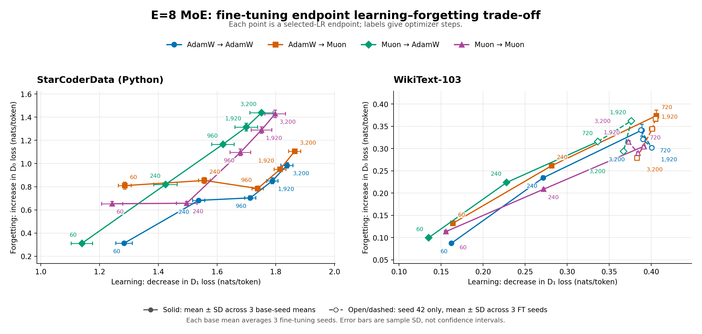
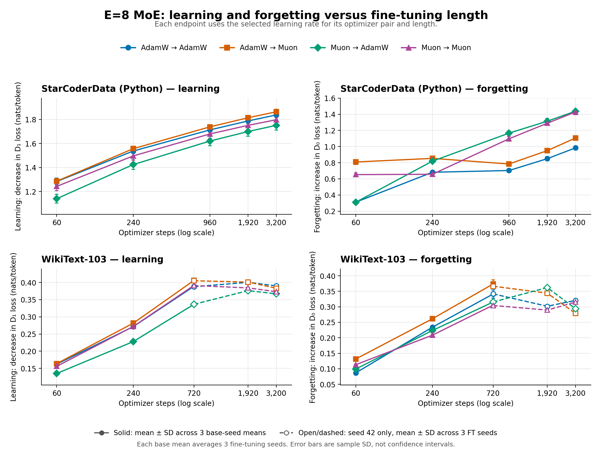

# StarCoderData: long-horizon main fine-tuning grid

**2026-11-27 · E=8 · Main-grid replication complete**

## Scientific objective and design

Harry approved the StarCoderData-only extension to test whether optimizer mismatch persists at 1,920 and 3,200 steps across pretrained initializations, before the matched-learning and router analyses. The earlier long pilot selected the same LR at 960, 1,920 and 3,200 steps for every pair. We reused those selected rates on the four remaining final 3B-token base checkpoints: AdamW and Muon × pretraining seeds 43 and 44. Every cell uses the three paired fine-tuning seeds 1–3. No additional LR sweep or WikiText training was performed.

- 8 jobs, one per remaining base/FT optimizer pair; 24 long trunks, 120 branch endpoints (48 new long results and 72 repeat short branches). The repeat branches are only validation controls and are **not** added as independent observations to the existing short-horizon results.
- AdamW fine-tuning LR `0.0006553816735340864`; Muon `0.000887386032940754`. Batch 65,536 tokens; 8-step warmup and final 20% decay. Same pinned base weights, frozen best-fit D0/D1 and paired batch order as before.
- Long horizons: 1,920 steps (125.8M tokens) and 3,200 steps (209.7M; approximately one effective StarCoderData pass).

## Results

Means ± sample SD of the three pretraining-seed means (each over three fine-tuning seeds); all numbers are nats/token. There are nine selected-LR runs per pair and horizon. The original 960-step values are shown for comparison.

| Pair | Steps | Learning | Forgetting |
|---|---:|---:|---:|
| AdamW → AdamW | 960 | 1.7131 ± 0.0188 | 0.7035 ± 0.0176 |
| | 1,920 | 1.7881 ± 0.0195 | 0.8502 ± 0.0257 |
| | 3,200 | 1.8379 ± 0.0205 | 0.9841 ± 0.0235 |
| AdamW → Muon | 960 | 1.7385 ± 0.0193 | 0.7845 ± 0.0219 |
| | 1,920 | 1.8146 ± 0.0203 | 0.9497 ± 0.0149 |
| | 3,200 | 1.8643 ± 0.0203 | 1.1058 ± 0.0201 |
| Muon → AdamW | 960 | 1.6203 ± 0.0385 | 1.1662 ± 0.0140 |
| | 1,920 | 1.6999 ± 0.0385 | 1.3140 ± 0.0334 |
| | 3,200 | 1.7516 ± 0.0394 | 1.4379 ± 0.0137 |
| Muon → Muon | 960 | 1.6795 ± 0.0351 | 1.0961 ± 0.0294 |
| | 1,920 | 1.7514 ± 0.0355 | 1.2891 ± 0.0277 |
| | 3,200 | 1.7979 ± 0.0354 | 1.4283 ± 0.0327 |

The StarCoderData curves are now fully replicated solid lines through 3,200 steps. WikiText's long points remain seed-42-only open/dashed results. The endpoint graph connects independently decayed and LR-selected endpoints, not the training-time checkpoints of a single run.

### Interpretation (descriptive)

- Across all four optimizer pairs, held-out learning and forgetting continue to increase from 960 to 1,920 to 3,200. This differs from WikiText's multi-epoch plateau/decline.
- For AdamW-pretrained models, Muon fine-tuning has more learning and more forgetting at each long endpoint. At 3,200 the mean endpoint forgetting gap is 0.1217 and the learning gap is 0.0264, with consistent direction of both gaps across base seeds. These are not matched-learning contrasts.
- For Muon-pretrained models, AdamW fine-tuning achieves less learning at both long lengths. The mean forgetting gap relative to matching Muon narrows from 0.0701 at 960 to 0.0249 at 1,920 and 0.0096 at 3,200; endpoint forgetting can be similar despite unequal achieved learning. This is not proof that the mismatch effect disappears at matched learning.
- The six-base common learning support (maximum threshold attained by every selected trajectory) is 1.65454 at 1,920 and 1.70389 at 3,200. The corresponding seed-42-only supports were 1.71865 and 1.76935. Formal mismatch contrasts and replay/correlation results remain uncomputed pending the predeclared threshold and main horizon.

## Verification and provenance

All 120 result records are completed, and all 1,368 evaluation snapshots were found in both scratch and pool. The eight job logs report 15 successful W&B uploads each; all 120 stable IDs, matching metadata digests, groups and completion markers were verified online. [W&B project](https://wandb.ai/hgo-mit/nanochat).

At final check, seven Slurm jobs were accounted as successful `COMPLETED`; job 30673395 still appeared `RUNNING` in `sacct` while `squeue` could not contact the controller. Its 15 completed branches, W&B completion messages and all scratch/pool files are present. Scientific completion is verified; final scheduler accounting for that job and exact aggregate GPU-hours are not independently confirmed because of the controller outage.

Data fingerprints match across optimizer pairs and all runs at each length/seed (15 groups). The 72 paired short-branch reproductions match their original base hashes, D0/D1 identities and training-data fingerprints.

| Repeat length | Pairs | Median abs Δ learning | Median abs Δ forgetting | Max abs Δ learning | Max abs Δ forgetting |
|---|---:|---:|---:|---:|---:|
| 60 | 24 | 0.00148 | 0.00113 | 0.01158 | 0.02931 |
| 240 | 24 | 0.00036 | 0.00295 | 0.00143 | 0.01685 |
| 960 | 24 | 0.00021 | 0.00399 | 0.00287 | 0.03886 |

The largest 960 forgetting discrepancy is Muon-base seed 43 → AdamW, FT seed 1. Its trajectories already differ before the first replay window (e.g. loss discrepancies at step 32), while batch fingerprints match and later learning agrees closely. This is numerical/run-to-run variability consistent with earlier GPU divergence, not evidence of recurrence of the replay bug. We retain the original shorter observations in the main dataset and do not silently discard the observed variation.

The analysis script passed for both long lengths, using `finetune_pilot_long/` for seed-42 LR selection and `finetune_main_long/` for the new seed-43/44 runs. It reads 72 runs per length (including pilot grid points; 36 selected). Exact selected records and per-seed endpoint tables are in [the endpoint CSV](../results/e8/finetune_endpoint_runs.csv) and the [combined report](finetuning_mismatch_endpoints.md). All actual paths are in [CHECKPOINTS.md](../CHECKPOINTS.md).
